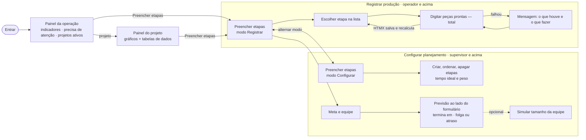

# Redesign de UX: registrar, acompanhar e configurar (2026-10-28)

Briefing: `TEROZ_prompt_redesign_atualizado.md` (prompt mestre). Escopo das telas: templates, CSS, JS de tela e
contexto de rota. Sem mudança de schema, de cálculo (`calc.py`) ou de permissão. Nenhum dado inventado: tudo que
aparece já vinha do servidor (ADR-0009).

## 0. Onde está cada entrega pedida no prompt

O prompt pede oito documentos; o projeto já tem `docs/design/` (telas) e `docs/plano/` (sistema), então cada um foi
para o lugar equivalente em vez de duplicar:

| Pedido no prompt | Onde ficou |
|---|---|
| `docs/ux-audit.md` | `docs/design/auditoria-2026-10-27.md` (auditoria das telas) + seções 1 a 4 deste arquivo |
| `docs/ux-benchmark.md` | [`docs/design/ux-benchmark.md`](ux-benchmark.md) |
| `docs/chart-audit.md` | seção 5 deste arquivo |
| `docs/ux-copy-inventory.md` | [`docs/design/ux-copy-inventory.md`](ux-copy-inventory.md) |
| `docs/ui-component-decisions.md` | [`docs/design/ui-component-decisions.md`](ui-component-decisions.md) |
| `docs/system-audit.md` | [`docs/plano/system-audit.md`](../plano/system-audit.md) |
| `docs/system-findings.md` | [`docs/plano/system-findings.md`](../plano/system-findings.md) |
| `docs/redesign-validation.md` | seção 7 deste arquivo |

## 1. Três trabalhos separados

| Trabalho | Quem | Onde | Ação principal |
|---|---|---|---|
| Registrar produção | operador, supervisor | Preencher etapas, modo **Registrar produção** (padrão) | digitar o total de peças prontas de cada subatividade |
| Acompanhar operação | todos | Painel da operação (`/app`) e painel do projeto | ver o que está atrasado e onde está cada projeto |
| Configurar planejamento | supervisor+ | Preencher etapas, modo **Configurar etapas**; Meta e equipe | criar/ordenar etapas, tempos ideais, pesos, meta, equipe, prazo |

## 2. Mapa das telas

| Tela | Arquivos | Dados (servidor) | Ação principal | Testes |
|---|---|---|---|---|
| Preencher etapas | `preencher/fill.html`, `_partes.html`, `_painel.html`; `blueprints/preencher.py` (`_modo`), `edicao.py` (`_back`); `static/js/preencher.js` | `_fill_ctx` (etapas, resultado do `calc`, `modo`) | salvar "Peças prontas (total)" | `test_redesign_preencher.py`, `test_r3_r5_rotas.py`, `test_etapa_d.py`, `test_fase6.py`, `test_isolation.py`, `test_auditoria_sistema.py` |
| Painel da operação | `app/painel.html`; `blueprints/app.py::home` | `dashboard.painel_operacao` (resumo, pendências, contagem, projetos, próximo prazo) | abrir o projeto que precisa de atenção | `test_etapa_e.py`, `test_visual.py`, `test_fase6.py`, `test_auditoria_sistema.py` |
| Meta e equipe | `preencher/goal_team.html`, `_equipe.html`, `_equipe_oob.html` | `_team_ctx` (previsão, tabela de equipes, `prazo` via `dashboard.situacao_prazo`) | ajustar meta, pessoas, horas por dia e prazo | `test_r3_r5.py`, `test_r3_r5_rotas.py` |
| Painel do projeto | `app/project_dashboard.html`, `static/js/painel.js` | `dashboard.painel_projeto` | ler o andamento do projeto | `test_etapa_e.py` |

## 3. Fluxo

O operador nunca vê o seletor de modo; `?modo=configurar` sem permissão cai em Registrar (o servidor decide em
`_modo()`), e as rotas de configuração continuam recusando no backend. Nenhuma etapa fica sem saída: salvar responde
"Salvo · quem, hora", conflito explica o valor atual, falha diz o que fazer e sessão encerrada leva ao login e volta.

## 4. Melhorias por tela

**Preencher etapas**
- Seletor segmentado "Registrar produção / Configurar etapas" ao lado do status de salvamento. O modo viaja nos
  formulários e redirecionamentos (`modo` oculto, `_back()`).
- Em Registrar, somem colunas e controles de planejamento (tempo ideal, peso, tempo total, tempo que falta, menus,
  nova subatividade, apagadas, apagar etapa). O nome da etapa vira título com "Etapa n de N · situação".
- Lista de etapas: uma barra (progresso pelas tarefas) e uma linha com a situação e "x de y unid. prontas".
- Campo editável com aparência de campo, não de célula amarela.
- "Peças prontas (total)" com dica curta: é o acumulado, não o do dia.
- Caixa "Unidades prontas da etapa (conta a subatividade mais atrasada)" no lugar de "Unidades prontas ÷ meta (a menor
  contagem entre as subatividades)".
- Falha ao salvar sem internet, com a página expirada ou com erro no servidor agora diz que não salvou e o que fazer
  (F-04); sessão encerrada leva ao login em vez de marcar "salvo" (F-01).
- Configurar a 1280 px: nomes das subatividades legíveis e tabela sem rolagem lateral (1024, 1280 e 1440 px).
- Celular (< 48em): linhas da tabela viram cartões com rótulo por campo; painel da etapa antes da lista abaixo de 80em.

**Painel da operação**
- Título igual ao menu e ao link de volta: "Painel da operação" (antes "Operação", "Painel" e "Painel da operação").
- 4 indicadores: progresso pelas tarefas (com barra e horas trabalhadas/previstas), unidades prontas, horas que
  faltam e próximo prazo (com a folga/atraso no tom certo, "dias úteis" por extenso).
- "Precisa de atenção" logo abaixo: etapas atrasadas e aguardando peça com link direto, ou mensagem explícita de
  que nada precisa de atenção; contagem das situações em uma linha.
- Lista de projetos ativos com cabeçalhos explícitos e aviso quando está truncada.
- 16 consultas ao banco qualquer que seja o número de projetos (antes ~10 por projeto, F-03).

**Meta e equipe**
- Previsão ao lado do formulário: "Com a equipe atual: N pessoas × h por dia", "Termina em X · folga/atraso de N dias
  úteis", data do prazo e dias úteis até ele, mais os dois totais de dias de trabalho.
- A tabela de simulação de equipes fica recolhida em "Simular o tamanho da equipe".

**Em todo o sistema**
- "d.u." virou "dias úteis"/"dia útil" (painéis, lista de projetos, e-mail semanal).
- Clique duplo em formulário comum não cria registro duplicado (F-05).
- Logotipo com nome acessível também no tema escuro.

## 5. Auditoria dos gráficos

Critério do prompt: cada gráfico precisa responder a uma pergunta concreta melhor do que um número, uma frase ou uma
lista. Todos os números vêm de `calc.py` via `dashboard.py`; o `painel.js` só desenha.

| Tela | Gráfico | Pergunta | Métrica e unidade | Por que gráfico | Sem tooltip | 0 / 1 / muitos | Decisão |
|---|---|---|---|---|---|---|---|
| Painel da operação | Tarefas × unidades por projeto | qual projeto está mais avançado? | % | não: repetia as colunas da lista | — | — | **removido** |
| Painel da operação | Rosca de situações | quantas etapas em cada situação? | contagem | não: 5 números cabem numa linha | — | — | **removido** (linha de contagem em "Precisa de atenção") |
| Painel da operação | Horas por projeto | onde está o trabalho que falta? | h | não: repetia "Horas que faltam" | — | — | **removido** |
| Painel da operação | Equipe × prazo por projeto | a equipe dá conta do prazo? | dias úteis | não: repetia "Prazo"; a simulação é por projeto | — | — | **removido** |
| Painel do projeto | Barras tarefas × unidades por etapa | quais etapas avançam nas tarefas mas não fecham unidades? | % e unidades | compara duas métricas diferentes por etapa, lado a lado | valores escritos nas barras + tabela de dados | sem etapas: estado vazio; o gráfico cresce uma linha por etapa | **mantido** (pedido do dono) |
| Painel do projeto | Rosca de situação | como o projeto se divide por situação? | contagem de etapas | composição de um total com o número no centro | legenda com contagem + lista "Etapas atrasadas" | sem etapas: estado vazio | **mantido** (pedido do dono) |
| Painel do projeto | Mapa de blocos "Quanto cada etapa representa" | quais etapas pesam mais no projeto? | % do tempo total | área = peso, comparação rápida de muitas etapas | nome e % escritos no bloco + tabela de dados | etapas sem tempo: aviso "sem tempo definido" | **mantido** (pedido do dono) |
| Painel do projeto | Horas por etapa (colunas empilhadas) | onde estão as horas que faltam? | h | trabalhadas e faltam na mesma coluna, por etapa | total escrito no título + tabela de dados | idem | **mantido** (pedido do dono) |
| Painel do projeto | Equipe × prazo | quantas pessoas cabem no prazo? | dias úteis | mostra o efeito do tamanho da equipe contra a linha do prazo | nota "Hoje: N pessoas · X dias úteis · prazo em Y" + linha "prazo: N dias úteis" + tabela | sem prazo: sem linha de prazo | **mantido** (pedido do dono) |
| Meta e equipe | Tabela de equipes 1 a 6 pessoas | e se a equipe mudar? | dias úteis | é tabela, não gráfico | — | — | **mantida, recolhida** |
| Ambos | Esteira de etapas | — | — | supunha processo linear e era um retângulo solto | — | — | **removida** (pedido do dono, 2026-10-27) |

Cores: as de situação são as mesmas em barras, rosca, etiquetas e listas (tokens `--color-status-*`); o oliva nunca
colore dado. A Operação não carrega mais ECharts nem `painel.js`.

## 6. Arquivos alterados

- **Telas:** `app/templates/preencher/{fill,_partes,_painel,_equipe,_equipe_oob,goal_team}.html`,
  `app/templates/app/{painel,projects}.html`, `app/templates/components/brand.html`,
  `app/templates/emails/weekly_report.{html,txt}`.
- **Estilo e JS:** `app/static/css/pages.css`, `app/static/js/{preencher,app}.js`, `app/static/dist/*` (rebuild).
- **Servidor:** `app/blueprints/{preencher,edicao,app}.py`, `app/services/{dashboard,projects,holidays}.py`,
  `app/security.py`.
- **Dependência:** `requirements.txt` (`Pillow==13.0.0`, F-02).
- **Testes:** `tests/test_redesign_preencher.py` e `tests/test_auditoria_sistema.py` (novos),
  `tests/test_fase4_routes.py` (o texto esperado passou de "d.u." para "dias úteis", com padrão mais estrito).

## 7. Validação

| O quê | Como | Resultado |
|---|---|---|
| Suíte completa | `python -m pytest -q` (SQLite) | 1132 passaram, 84 pulados (precisam de PostgreSQL), 3 falhas esperadas (xfail), 0 falhas |
| PostgreSQL / RLS | `TEST_DATABASE_URL` | **não rodado** (sem PostgreSQL nesta sessão) |
| Arquivos estáticos | `python scripts/build_assets.py --check` | em dia |
| Dependências | `pip-audit` (produção e desenvolvimento) | nenhuma vulnerabilidade conhecida |
| Revisão de segurança do diff | `/security-review` nas mudanças pendentes (redirecionamento do HTMX, cache de feriados, carga das etapas, modo, JS, templates) | nenhum achado |
| Acessibilidade automática | axe-core (WCAG 2.0/2.1 A e AA) em Painel da operação, Registrar, Configurar, Meta e equipe e Projetos, 1280 e 375 px, claro e escuro | 0 violações (havia 1: link do logotipo sem nome no escuro) |
| Teclado | Tab por ~45 elementos em cada tela | foco visível em todos (a linha da tabela recebe o contorno do link) |
| Reflow | 640 px (zoom 200%) e 320 px (400%) | sem rolagem lateral |
| Alvos de toque (375 px) | menor lado dos controles | "Lista completa" passou de 20 px para 44 px; os demais abaixo de 24 px têm área de clique maior (cartão inteiro) |
| Falhas | navegador: sessão encerrada, cookies apagados, sem internet, duas abas, clique duplo | mensagem certa em cada caso; nada marcado como salvo sem salvar |
| Telas | 1280 e 375 px, claro e escuro, mais 768, 1024 e 1440 em Configurar | sem rolagem lateral nem erro no console |

## 8. Problemas conhecidos

Ver `docs/plano/system-findings.md`: F-06 ("etapa atrasada" supõe etapas em sequência, decisão do dono), F-08
(código de gráficos sem uso), F-09 (PostgreSQL), F-10 (nome "Controle de Produção" nos títulos), F-11 (mensagem de
falha na folha de registro do detalhe do projeto).
