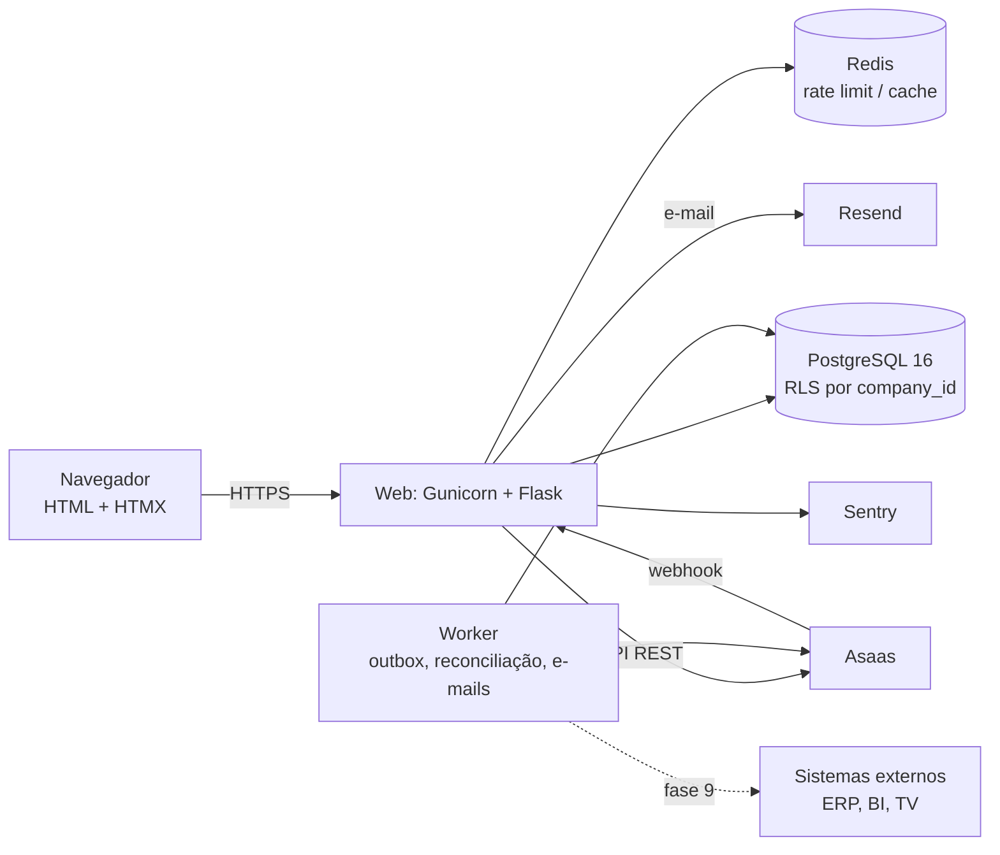
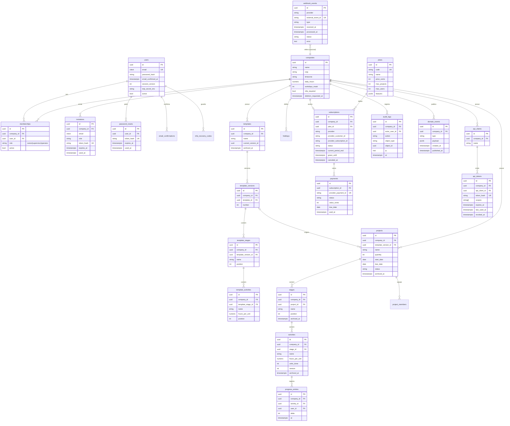

# Arquitetura

Status: rascunho para aprovação · Atualizado: 2026-10-13

## 1. Ponto de partida e o que muda

O repositório começou vazio (só `README.md`). Não há código a preservar. Os módulos que o
roteiro trata como existentes nascem na **Fase 0** com estes contratos:

| Módulo | Contrato | Por quê |
|---|---|---|
| `app/services/calc.py` | Funções puras: `progresso(atividades)`, `unidades_concluidas`, `horas_restantes`, `dias_uteis_entre(inicio, fim, feriados, dias_semana)`, `prazo_previsto(horas, capacidade_diaria, ...)`. Sem Flask, sem banco, só tipos simples/dataclasses. | Regra de negócio testável à mão e reaproveitável na API |
| `app/tenancy.py` | `load_company()` (before_request: lê `company_id` da sessão, valida vínculo ativo, põe em `g.company`/`g.membership`), `tenant_required(min_role)`, `scoped(Model)` (query já filtrada por `company_id`), `get_or_404(Model, id)` escopado. | Isolamento num único lugar |
| `tests/test_isolation.py` | Fixture com empresas A e B; cada rota com `<uuid>` testada com recurso de B logado em A → 404. | Regra inviolável 1 |

## 2. Componentes



- **Web**: Flask 3 com app factory e blueprints: `public` (site), `auth`, `app` (área
  logada, prefixo `/app`), `billing`, `webhooks`, `api_v1` (só com flag), `dev` (só em
  development: `/estilo`).
- **Worker**: processo separado (`flask worker`) que roda jobs periódicos: e-mails pendentes,
  reconciliação do Asaas, limpeza de tokens, apagamento LGPD e, na fase 9, entrega do outbox.
  Sem Celery no MVP: loop simples com `SELECT ... FOR UPDATE SKIP LOCKED`.
- **Templates**: Jinja com macros em `app/templates/components/`, tokens em
  `app/static/css/tokens.css`, HTMX e fontes servidos pelo próprio site.

### Estrutura de pastas alvo

```
app/
  __init__.py          # create_app
  config.py            # Config por ambiente, tudo de env
  extensions.py        # db, migrate, login, csrf, limiter
  tenancy.py
  models/              # um arquivo por agregado
  services/            # calc.py, projects.py, templates.py, entitlements.py,
                       # importer.py, exporter.py, events.py, audit.py, billing/
  blueprints/          # public, auth, app, billing, webhooks, api_v1, dev
  templates/           # base_publica.html, base_app.html, components/, páginas
  static/              # css/, js/htmx.min.js, fonts/, img/
migrations/
tests/
docs/plano/, docs/api/
```

## 3. Fluxo de uma requisição (área logada)

1. Gunicorn recebe; middleware gera `request_id` e o põe no log.
2. Flask-Login carrega o usuário pelo `session_token` versionado (revogação imediata).
3. `tenancy.load_company()` lê `company_id` da sessão, confere vínculo ativo e papel;
   abre a transação com `SET LOCAL app.company_id = :id` (RLS).
4. `tenant_required(min_role)` barra papel insuficiente (403) e, para escrita,
   `entitlements` barra modo leitura/limite de plano (402).
5. A view chama um serviço; o serviço usa `scoped()` e grava `domain_events`/`audit_logs`
   na mesma transação.
6. Resposta: página inteira ou fragmento HTMX (`HX-Request`); CSP com nonce.

## 4. Modelo de dados alvo

Todas as chaves primárias são UUID. Tabelas com dado de cliente têm `company_id NOT NULL`
e índices compostos começando por `company_id`.



Observações:
- **Snapshot de modelo**: criar projeto copia `template_stages/activities` para
  `stages/activities` e guarda `template_version_id`. Editar o modelo cria nova versão; o
  projeto só muda com confirmação explícita (registrada no histórico).
- **Concorrência**: `activities.version` para controle otimista (409 no conflito).
- **Histórico**: `progress_entries` é append-only; arquivar nunca apaga.
- **Holidays**: feriados nacionais (seed) + feriados da empresa; alimentam `calc.dias_uteis`.

## 5. Estratégia multiempresa

Três barreiras, da mais importante à de reserva:
1. **Aplicação**: `company_id` vem só da sessão (`g.company.id`); toda consulta passa por
   `scoped()`/`get_or_404()` de `tenancy.py`; recurso de outra empresa responde 404.
2. **Testes**: `tests/test_isolation.py` percorre o `url_map` e falha se uma rota com
   `<uuid:...>` não tiver caso A/B (fase 7); cada rota nova ganha caso já na sua fase.
3. **Banco (RLS)**: políticas `USING (company_id = current_setting('app.company_id')::uuid)`
   em todas as tabelas de cliente; o app conecta com um papel sem `BYPASSRLS`. Ligado por
   `RLS_ENABLED` (ADR-0003).

Vínculo com várias empresas: `memberships` N:N; a troca de empresa reescreve
`session['company_id']` após validar o vínculo.

## 6. Autenticação

- Flask-Login + senha com Argon2id (`argon2-cffi`).
- Sessão: cookie `__Host-session`, Secure, HttpOnly, SameSite=Lax; `session_version` no
  usuário invalida todas as sessões (reset de senha, desativação, “sair de todos”).
- Tokens (confirmação, convite, reset, API): 32 bytes aleatórios, só o SHA-256 vai ao banco,
  uso único e expiração.
- MFA TOTP (`pyotp`) opcional; obrigatório para `owner` quando a empresa ativar; códigos de
  recuperação com hash.
- Bloqueio progressivo por conta e por IP + Flask-Limiter (Redis em produção).

## 7. Pagamento

- Interface `PaymentProvider` (`app/services/billing/provider.py`): `create_customer`,
  `create_subscription`, `change_plan`, `cancel`, `get_subscription`, `list_payments`.
  Implementações `AsaasProvider` (header `access_token`, base URL por env) e `FakeProvider`.
- Estados locais: `trialing → active ⇄ past_due → (grace) → expired`; `canceled` vale até
  `current_period_end`. `expired`/sem assinatura = modo leitura (nunca apaga dados).
- Webhook `POST /webhooks/asaas`: `hmac.compare_digest` do header `asaas-access-token`,
  `INSERT` em `webhook_events` com `external_event_id` UNIQUE antes de processar, resposta
  rápida; eventos fora de ordem → consulta o estado atual no Asaas.
- Reconciliação diária no worker (`flask billing-reconcile`).
- Nenhum dado de cartão passa pelo servidor: checkout do Asaas.

## 8. Eventos de domínio (outbox)

- `app/services/events.py::emit(type, payload)` adiciona uma linha em `domain_events` na
  **mesma transação** da mudança. Tipos do MVP: `project.created`,
  `activity.progress_updated`, `stage.completed`, `project.completed`.
- No MVP nada consome além das métricas internas. Na fase 9 o worker lê
  `published_at IS NULL` com `FOR UPDATE SKIP LOCKED` e entrega aos webhooks de saída.

## 9. API de publicação (fase 9, atrás de `FEATURE_PUBLIC_API`)

- Blueprint `/api/v1` registrado só com a flag ligada (desligada → 404).
- Autenticação `Authorization: Bearer <token>`; token por empresa, hash no banco, escopos
  `read:projects` e `write:progress`; rate limit por token; toda chamada em `audit_logs`.
- Contrato em `docs/api/openapi.yaml` (OpenAPI 3.1), erros RFC 9457, paginação por cursor,
  datas ISO 8601 UTC. `GET /projects/{id}/summary` devolve a saída de `calc.py`.
- Webhooks de saída: HMAC-SHA256 + timestamp, retentativas com backoff, bloqueio de IPs
  privados (SSRF).

## 10. Configuração e ambientes

| Variável | Uso |
|---|---|
| `SECRET_KEY`, `DATABASE_URL`, `REDIS_URL` | básicos |
| `RLS_ENABLED`, `FEATURE_PUBLIC_API` | flags |
| `ASAAS_API_KEY`, `ASAAS_BASE_URL`, `ASAAS_WEBHOOK_TOKEN` | pagamento |
| `EMAIL_BACKEND`, `RESEND_API_KEY`, `MAIL_FROM` | e-mail |
| `SENTRY_DSN` | monitoramento |

Ambientes: `development` (SQLite ou Postgres local via docker-compose, e-mail no console),
`test` (Postgres via `TEST_DATABASE_URL`), `staging` e `production` (Render, segredos
distintos).
