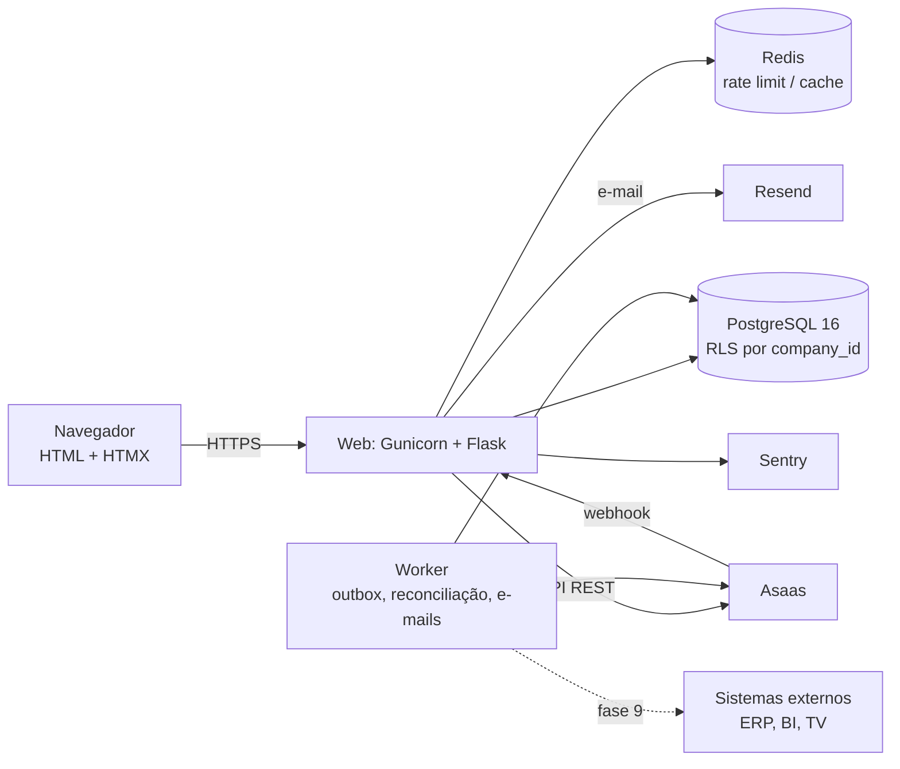

# Arquitetura

Status: rascunho para aprovação (§4 e §5 implementados na Fase 3) · Atualizado: 2026-10-13

## 1. Ponto de partida e o que muda

O repositório começou vazio (só `README.md`). Não há código a preservar. Os módulos que o
roteiro trata como existentes nascem na **Fase 0** com estes contratos:

| Módulo | Contrato | Por quê |
|---|---|---|
| `app/services/calc.py` | Funções puras que reproduzem as fórmulas da planilha de referência (ver §1.1): `peso_atividade`, `pct_atividade`, `progresso_tarefas`, `unidades_etapa`, `unidades_projeto`, `tempo_total_min`, `tempo_restante_min`, `dias_uteis_restantes(horas, pessoas, horas_dia)`; e, acima da planilha, `prazo_em_data(inicio, dias, feriados, dias_semana)`. Sem Flask, sem banco, só tipos simples/dataclasses. | Regra de negócio testável contra a planilha e reaproveitável na API |
| `app/tenancy.py` | `load_company()` (before_request: lê `company_id` da sessão, valida vínculo ativo, põe em `g.company`/`g.membership`), `tenant_required(min_role)`, `scoped(Model)` (query já filtrada por `company_id`), `get_or_404(Model, id)` escopado. | Isolamento num único lugar |
| `tests/test_isolation.py` | Fixture com empresas A e B; cada rota com `<uuid>` testada com recurso de B logado em A → 404. | Regra inviolável 1 |

### 1.1 Base funcional: planilha `acompanhamento_montagem_v4.xlsx` e repositório `Controle-de-atividades`

A planilha de referência (cópia em `docs/referencia/`) e o painel Flask+Excel existente em
`pecordeiro/controle-de-atividades` definem as regras de negócio que o SaaS substitui. O
painel antigo roda só em Windows com Excel (COM), sem login nem histórico; **nada do seu
código é reaproveitado**, só as regras e os dados de exemplo.

| Conceito da planilha | Fórmula | Vira no SaaS |
|---|---|---|
| Meta de robôs | `B4` = unidades previstas de todas as etapas | `projects.quantity` |
| Etapa (24 blocos, nº 3–26 no exemplo; até 8 subatividades cada) | — | `stages` / `activities` (sem limite fixo de 8) |
| Tempo ideal (min) por subatividade | entrada | `activities.ideal_minutes` |
| Peso na etapa | `tempo_ideal ÷ soma dos tempos da etapa` | `calc.peso_atividade` |
| Peso da etapa no robô | `tempo da etapa ÷ tempo de 1 robô` | `calc.peso_etapa` |
| % da subatividade | `min(1, peças_concluídas ÷ previstas)` | `calc.pct_atividade` |
| Progresso da etapa (Tabela 1, tarefas) | `Σ(peso × %)`; se soma de tempos = 0, média simples | `calc.progresso_tarefas` |
| Unidades concluídas da etapa (Tabela 2) | `round(min(%) × previstas)`; uma unidade só está pronta ao passar por todas as subatividades | `calc.unidades_etapa` |
| Robôs concluídos | `min` das unidades concluídas entre todas as etapas | `calc.unidades_projeto` |
| Status da etapa | Concluída se feitas ≥ previstas; Em andamento se feitas > 0 ou progresso > 0; senão Não iniciada | `calc.status_etapa` |
| Tempo total / que falta | `ideal × previstas` / `ideal × (previstas − min(previstas, peças))` | `calc.tempo_*_min` |
| Dias úteis restantes (aba Equipe) | `horas que faltam ÷ (pessoas × horas por dia)`, equipe em paralelo | `calc.dias_uteis_restantes`; pessoas e horas/dia vêm do projeto |
| Progresso geral | `1 − tempo que falta ÷ tempo total` (ponderado por tempo) | `calc.progresso_geral` |

Os casos de teste de `calc.py` na Fase 0 usam a própria planilha como **fonte de verdade**:
valores calculados pelo Excel (cache do `.xlsx`) viram os resultados esperados.

## 2. Componentes



- **Web**: Flask 3 com app factory e blueprints: `public` (site), `auth`, `app` (área
  logada, prefixo `/app`), `billing`, `webhooks`, `api_v1` (só com flag), `dev` (só em
  development: `/estilo`).
- **Worker** (Etapa F, ADR-0010): processo separado (`flask worker run`, `--once` para cron)
  que consome o outbox (`domain_events`, um evento por transação com `FOR UPDATE SKIP LOCKED`,
  tentativas com backoff) e roda tarefas idempotentes: alertas, relatório semanal,
  reconciliação do Asaas e limpeza de tokens. Empresa a empresa com `rls.set_context`, sem
  papel `BYPASSRLS`. Sem Celery. Runbook em [`worker.md`](worker.md).
- **Templates**: Jinja com macros em `app/templates/components/`, tokens em
  `app/static/css/tokens.css`, HTMX e fontes servidos pelo próprio site.

### Estrutura de pastas alvo

```
app/
  __init__.py          # create_app
  config.py            # Config por ambiente, tudo de env
  extensions.py        # db, migrate, login, csrf, limiter
  tenancy.py
  models/              # um arquivo por agregado
  services/            # calc.py, projects.py, templates.py, entitlements.py,
                       # importer.py, exporter.py, events.py, audit.py, billing/
  blueprints/          # public, auth, app, billing, webhooks, api_v1, dev
  templates/           # base_publica.html, base_app.html, components/, páginas
  static/              # css/, js/htmx.min.js, fonts/, img/
migrations/
tests/
docs/plano/, docs/api/
```

## 3. Fluxo de uma requisição (área logada)

1. Gunicorn recebe; middleware gera `request_id` e o põe no log.
2. Flask-Login carrega o usuário pelo `session_token` versionado (revogação imediata).
3. `tenancy.load_company()` lê `company_id` da sessão, confere vínculo ativo e papel;
   abre a transação com `SET LOCAL app.company_id = :id` (RLS).
4. `tenant_required(min_role)` barra papel insuficiente (403) e, para escrita,
   `entitlements` barra modo leitura/limite de plano (402).
5. A view chama um serviço; o serviço usa `scoped()` e grava `domain_events`/`audit_logs`
   na mesma transação.
6. Resposta: página inteira ou fragmento HTMX (`HX-Request`); CSP com nonce.

## 4. Modelo de dados (implementado na Fase 3)

Todas as chaves primárias são UUID. Tabelas com dado de cliente têm `company_id NOT NULL`
e pelo menos um índice (ou UNIQUE) começando por `company_id` — conferido por
`tests/test_schema.py` inspecionando o metadata. Exceções, com motivo: `companies` (raiz do
tenant), `users`, `password_resets`, `email_confirmations`, `mfa_recovery_codes`
(identidade global do usuário), `plans` (catálogo), `webhook_events` (caixa de entrada da
plataforma) e `holidays` (`company_id` NULL = feriado nacional). Migrations:
`e972bfba83c7` (Fase 0) → `e05ae54663a3` (schema da Fase 3) → `b3e9f1a2c4d5` (políticas
RLS) → `a7c2d4e8f901` (seed dos planos).

```mermaid
erDiagram
  companies ||--o{ memberships : tem
  users ||--o{ memberships : tem
  companies ||--o{ invitations : emite
  users ||--o{ password_resets : pede
  users ||--o{ email_confirmations : confirma
  users ||--o{ mfa_recovery_codes : guarda

  companies ||--o{ templates : possui
  templates ||--o{ template_versions : versiona
  templates |o--o| template_versions : "versão atual"
  template_versions ||--o{ template_stages : contem
  template_stages ||--o{ template_activities : contem

  companies ||--o{ projects : possui
  template_versions |o--o{ projects : "origem (snapshot)"
  projects ||--o{ stages : contem
  stages ||--o{ activities : contem
  activities ||--o{ progress_entries : registra
  users |o--o{ progress_entries : registrou
  companies |o--o{ holidays : "define (NULL = nacional)"

  plans ||--o{ subscriptions : define
  companies ||--o| subscriptions : assina
  subscriptions ||--o{ payments : cobra
  companies ||--o{ payments : paga
  companies |o--o{ webhook_events : "refere (opcional)"

  companies ||--o{ audit_logs : registra
  companies ||--o{ domain_events : publica
  companies ||--o{ api_clients : possui
  api_clients ||--o{ api_tokens : emite

  companies {
    uuid id PK
    string name
    string cnpj
    string timezone
    numeric daily_hours "CHECK 0 < h <= 24"
    int workdays_mask "CHECK 0..127"
    bool mfa_required
    timestamptz deletion_requested_at
  }
  users {
    uuid id PK
    string email UK "UNIQUE lower(email)"
    string password_hash
    timestamptz email_confirmed_at
    int session_version
    string totp_secret_enc
    bool mfa_enabled
    bool active
  }
  memberships {
    uuid id PK
    uuid company_id FK
    uuid user_id FK
    string role "CHECK owner|supervisor|operator"
    bool active
  }
  invitations {
    uuid id PK
    uuid company_id FK
    string email "CHECK minúsculas"
    string role "CHECK"
    string token_hash UK
    uuid invited_by_user_id FK
    timestamptz expires_at
    timestamptz used_at
    timestamptz revoked_at
  }
  password_resets {
    uuid id PK
    uuid user_id FK
    string token_hash UK
    timestamptz expires_at
    timestamptz used_at
  }
  email_confirmations {
    uuid id PK
    uuid user_id FK
    string email
    string token_hash UK
    timestamptz expires_at
    timestamptz used_at
  }
  mfa_recovery_codes {
    uuid id PK
    uuid user_id FK
    string code_hash "UNIQUE (user_id, code_hash)"
    timestamptz used_at
  }
  templates {
    uuid id PK
    uuid company_id FK
    string name "UNIQUE (company_id, name)"
    uuid current_version_id FK
    timestamptz archived_at
  }
  template_versions {
    uuid id PK
    uuid company_id FK
    uuid template_id FK
    int number "UNIQUE (company_id, template_id, number)"
    uuid created_by_user_id FK
  }
  template_stages {
    uuid id PK
    uuid company_id FK
    uuid template_version_id FK
    string name
    int position
  }
  template_activities {
    uuid id PK
    uuid company_id FK
    uuid template_stage_id FK
    string name
    numeric ideal_minutes "tempo ideal por unidade (min)"
    int position
  }
  projects {
    uuid id PK
    uuid company_id FK
    uuid template_version_id FK
    string name
    int quantity "CHECK >= 0"
    date start_date
    date due_date
    int people
    numeric hours_per_day
    string status "CHECK active|done"
    timestamptz archived_at
  }
  stages {
    uuid id PK
    uuid company_id FK
    uuid project_id FK
    string name
    int position
    timestamptz archived_at
  }
  activities {
    uuid id PK
    uuid company_id FK
    uuid stage_id FK
    string name
    numeric ideal_minutes "tempo ideal por unidade (min)"
    int units_done "CHECK >= 0"
    int version "controle otimista"
    timestamptz archived_at
  }
  progress_entries {
    uuid id PK
    uuid company_id FK
    uuid activity_id FK
    uuid user_id FK
    int delta "CHECK <> 0"
    timestamptz at
  }
  holidays {
    uuid id PK
    uuid company_id FK "NULL = nacional"
    date day "UNIQUE (company_id, day); nacional: UNIQUE parcial"
    string name
  }
  plans {
    uuid id PK
    string code UK
    string name
    int price_cents
    int max_projects "NULL = ilimitado"
    int max_users
    jsonb features
    bool active
  }
  subscriptions {
    uuid id PK
    uuid company_id FK "UNIQUE: 1 por empresa"
    uuid plan_id FK
    string provider "CHECK asaas|fake"
    string provider_customer_id
    string provider_subscription_id
    string status "CHECK trialing|active|past_due|canceled|expired"
    timestamptz trial_ends_at
    timestamptz current_period_end
    timestamptz grace_until
    timestamptz canceled_at
  }
  payments {
    uuid id PK
    uuid company_id FK
    uuid subscription_id FK
    string provider_payment_id UK
    string status "CHECK"
    int value_cents
    date due_date
    timestamptz paid_at
  }
  webhook_events {
    uuid id PK
    string provider
    string external_event_id UK
    string type
    uuid company_id FK "opcional"
    timestamptz received_at
    timestamptz processed_at
    string status "CHECK received|processed|ignored|failed"
    text error
  }
  audit_logs {
    uuid id PK
    uuid company_id FK
    uuid actor_user_id FK
    string action
    string object_type
    uuid object_id
    string ip
    jsonb details
    timestamptz at
  }
  domain_events {
    uuid id PK
    uuid company_id FK
    string type
    jsonb payload
    timestamptz created_at
    timestamptz published_at
    int attempts
  }
  api_clients {
    uuid id PK
    uuid company_id FK
    string name
    timestamptz revoked_at
  }
  api_tokens {
    uuid id PK
    uuid company_id FK
    uuid api_client_id FK
    string token_hash UK
    string token_prefix
    jsonb scopes
    timestamptz expires_at
    timestamptz last_used_at
    timestamptz revoked_at
  }
```



Observações:
- **Snapshot de modelo**: criar projeto copia `template_stages/activities` para
  `stages/activities` e guarda `template_version_id` (`services/templates.py`). Editar o
  modelo cria nova versão; o projeto só muda com confirmação explícita (Fase 4).
- **Concorrência**: `activities.version` para controle otimista (409 no conflito).
- **Histórico**: `progress_entries` e `audit_logs` são append-only (guarda no ORM);
  arquivar nunca apaga.
- **Feriados**: linha global com `company_id` NULL = feriado nacional (`flask
  seed-holidays`, idempotente; índice único parcial por dia) + feriados da empresa. Escolha
  da Fase 3 em vez de copiar os nacionais para cada empresa: um só lugar para corrigir; o
  RLS deixa todas lerem os nacionais e só gravar os próprios. `services/holidays.py`
  junta os dois para `calc.prazo_em_data`.
- **E-mail sem diferenciar maiúsculas**: índice único em `lower(email)` (igual no SQLite e
  no PostgreSQL) em vez de `citext`; a aplicação também grava em minúsculas.
- **JSON**: `JSONB` no PostgreSQL, `JSON` no SQLite (mesmo tipo no modelo).
- **Fica para depois**: `project_members` (equipe por projeto) entra quando a tela de
  equipe existir; FK composta `(company_id, id)` entre pai e filho (garantia de que o filho
  é da mesma empresa) está registrada como melhoria — hoje a garantia é do serviço + RLS.

## 5. Estratégia multiempresa

Três barreiras, da mais importante à de reserva:
1. **Aplicação**: `company_id` vem só da sessão (`g.company.id`); toda consulta passa por
   `scoped()`/`get_or_404()` de `tenancy.py`; recurso de outra empresa responde 404.
2. **Testes**: `tests/test_isolation.py` percorre o `url_map` e falha se uma rota com
   `<uuid:...>` não tiver caso A/B (fase 7); cada rota nova ganha caso já na sua fase.
3. **Banco (RLS)**: políticas
   `company_id = NULLIF(current_setting('app.company_id', true), '')::uuid` em todas as
   tabelas de cliente (`app/rls.py`); com `RLS_ENABLED=1` o app faz `SET LOCAL` da empresa
   (e do usuário) no início de cada transação; `flask rls enable` liga `ENABLE` + `FORCE`.
   O app conecta com papel sem `SUPERUSER`/`BYPASSRLS`. Pronto e desligado por padrão
   (ADR-0003).

Vínculo com várias empresas: `memberships` N:N; a troca de empresa reescreve
`session['company_id']` após validar o vínculo.

## 6. Autenticação

- Flask-Login + senha com Argon2id (`argon2-cffi`).
- Sessão: cookie `__Host-session`, Secure, HttpOnly, SameSite=Lax; `session_version` no
  usuário invalida todas as sessões (reset de senha, desativação, “sair de todos”).
- Tokens (confirmação, convite, reset, API): 32 bytes aleatórios, só o SHA-256 vai ao banco,
  uso único e expiração.
- MFA TOTP (`pyotp`) opcional; obrigatório para `owner` quando a empresa ativar; códigos de
  recuperação com hash.
- Bloqueio progressivo por conta e por IP + Flask-Limiter (Redis em produção).

## 7. Pagamento

- Interface `PaymentProvider` (`app/services/billing/provider.py`): `create_customer`,
  `create_subscription`, `change_plan`, `cancel`, `get_subscription`, `list_payments`.
  Implementações `AsaasProvider` (header `access_token`, base URL por env) e `FakeProvider`.
- Estados locais: `trialing → active ⇄ past_due → (grace) → expired`; `canceled` vale até
  `current_period_end`. `expired`/sem assinatura = modo leitura (nunca apaga dados).
- Webhook `POST /webhooks/asaas`: `hmac.compare_digest` do header `asaas-access-token`,
  `INSERT` em `webhook_events` com `external_event_id` UNIQUE antes de processar, resposta
  rápida; eventos fora de ordem → consulta o estado atual no Asaas.
- Reconciliação diária no worker (`flask billing-reconcile`).
- Nenhum dado de cartão passa pelo servidor: checkout do Asaas.

## 8. Eventos de domínio (outbox)

- `app/services/events.py::emit(type, payload)` adiciona uma linha em `domain_events` na
  **mesma transação** da mudança. Tipos do MVP: `project.created`,
  `activity.progress_updated`, `stage.completed`, `project.completed`.
- Etapa F: o worker lê `published_at IS NULL` (por empresa, `FOR UPDATE SKIP LOCKED`), chama o
  consumidor do tipo (`worker._handlers`: `activity.assigned` → e-mail ao responsável;
  `plan.visual_custom_contracted` → aviso à equipe) e marca `published_at`; erro → `attempts`,
  `next_attempt_at` (backoff) e `last_error`. Tipos sem consumidor (públicos) só são marcados
  até existirem os webhooks de saída.

## 9. API de publicação (fase 9, atrás de `FEATURE_PUBLIC_API`)

- Blueprint `/api/v1` registrado só com a flag ligada (desligada → 404).
- Autenticação `Authorization: Bearer <token>`; token por empresa, hash no banco, escopos
  `read:projects` e `write:progress`; rate limit por token; toda chamada em `audit_logs`.
- Contrato em `docs/api/openapi.yaml` (OpenAPI 3.1), erros RFC 9457, paginação por cursor,
  datas ISO 8601 UTC. `GET /projects/{id}/summary` devolve a saída de `calc.py`.
- Webhooks de saída: HMAC-SHA256 + timestamp, retentativas com backoff, bloqueio de IPs
  privados (SSRF).

## 10. Configuração e ambientes

| Variável | Uso |
|---|---|
| `SECRET_KEY`, `DATABASE_URL`, `REDIS_URL` | básicos |
| `RLS_ENABLED`, `FEATURE_PUBLIC_API` | flags (`RLS_ENABLED=1` + `flask rls enable`, ADR-0003) |
| `TEST_DATABASE_URL` | testes no PostgreSQL (nome do banco com “test”; o schema é recriado) |
| `ASAAS_API_KEY`, `ASAAS_BASE_URL`, `ASAAS_WEBHOOK_TOKEN` | pagamento |
| `EMAIL_BACKEND`, `RESEND_API_KEY`, `MAIL_FROM` | e-mail |
| `SENTRY_DSN` | monitoramento |
| `WORKER_INTERVAL_SECONDS`, `WORKER_EVENT_MAX_ATTEMPTS`, `STAFF_NOTIFY_EMAIL` | worker (Etapa F, `worker.md`) |

Ambientes: `development` (SQLite ou Postgres local via docker-compose, e-mail no console),
`test` (Postgres via `TEST_DATABASE_URL`), `staging` e `production` (Render, segredos
distintos).
