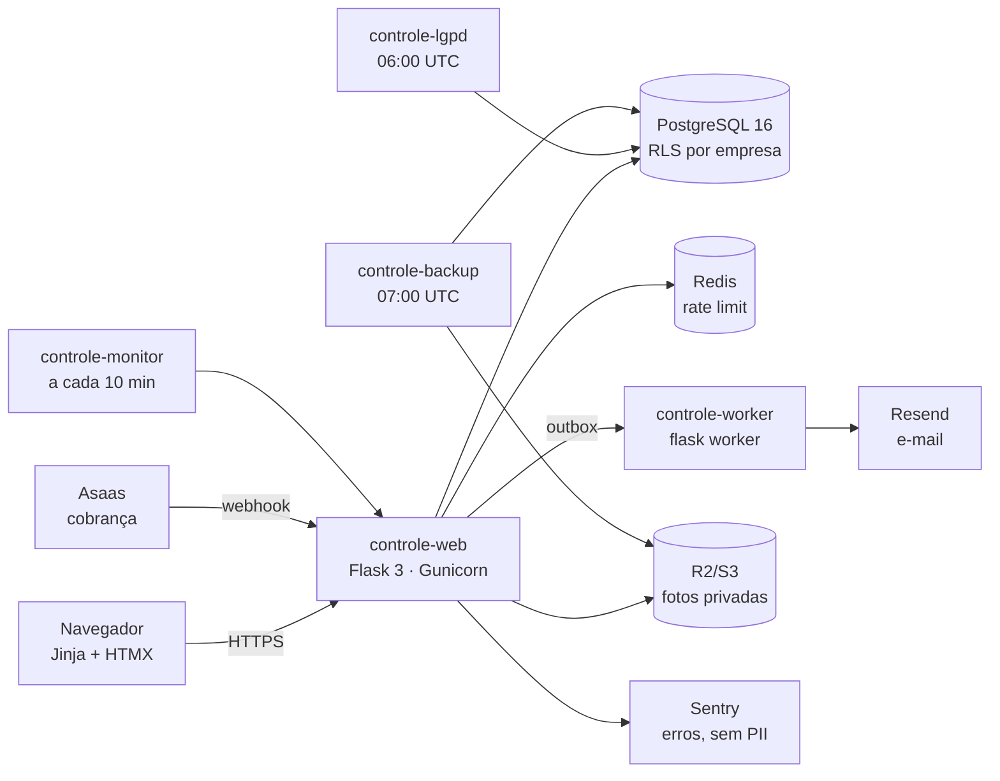

# Auditoria do sistema (2026-10-28)

Pedido: prompt mestre de redesign, seção 14 ("revisar o produto além do visual"). Base: o código desta branch
(`claude/prompt-mestre-producao-s2y4fq`), os documentos de `docs/plano/` e testes rodados nesta sessão.
Achados, gravidade e situação em [`system-findings.md`](system-findings.md).

**Como ler:** "conferido" quer dizer que o código foi lido E um teste ou uma execução comprovou. "Documentado" quer dizer
que o desenho está escrito e no código, mas não foi possível exercitar aqui. Isto não é uma auditoria formal nem
certificação de segurança.

## 1. Mapa do sistema

| Camada | Onde | Observação |
|---|---|---|
| Entrada | `run.py`, `gunicorn.conf.py`, `app/__init__.py` | fábrica do app, erros, Flask-Login |
| Rotas | `app/blueprints/` (19 blueprints) | `app` (painéis, projetos), `preencher`, `edicao`, `auth`, `account`, `empresa`, `billing`, `webhooks`, `api_v1`, `lgpd`, `interno`… |
| Regras | `app/services/` | cálculo puro em `calc.py`; números de tela em `dashboard.py`; projetos em `projects.py` |
| Dados | `app/models/` (13 módulos), `migrations/versions/` (24) | toda tabela de cliente com `company_id`; RLS em `app/rls.py` |
| Segurança HTTP | `app/security.py`, `app/tenancy.py`, `app/logging_config.py` | CSP com nonce, cookies `__Host-`, empresa só da sessão |
| Infra | `render.yaml`, `Dockerfile`, `docs/plano/operacao.md` | web, worker, 3 crons, PostgreSQL, Redis |
| Testes | `tests/` (55 arquivos) | SQLite por padrão; PostgreSQL com `TEST_DATABASE_URL` |

## 2. Fluxos críticos rastreados

| Fluxo | Caminho | Fonte de verdade | Situação |
|---|---|---|---|
| Lançar peças | célula → `preencher.activity_cells` → `projects.set_units_done` → `progress_entries` (diferença) + `activities.units_done` (total) | banco; versão otimista | conferido: o campo é o total acumulado (mandar o mesmo total de novo responde "Nada mudou." e não soma); 409 com mensagem quando outra pessoa mudou; operador não diminui |
| Números do painel | `projects.summary` → `calc.resumo_projeto` / `calc.resumo_operacao` → `dashboard.py` → template | `calc.py` | conferido: mesmos valores no Painel da operação, painel do projeto e Preencher etapas (dados de exemplo) |
| Previsão e prazo | `projects.forecast_end` → `calc.prazo_em_data` com feriados e dias da semana da empresa | `calc.py` + `holidays` | conferido: "hoje" e "Atualizado às" no fuso da empresa |
| Entrar e sessão | `auth.login` → Flask-Login com `session_version` | banco | conferido; ver F-01 para o pedido do HTMX com a sessão já encerrada |
| Assinatura | `entitlements.py` (limites no servidor) ← `webhooks.asaas` | banco (estado vindo do Asaas) | documentado e testado com dublê; Asaas real não exercitado |

## 3. Por área

| Área (§14) | O que foi feito | Resultado |
|---|---|---|
| 14.1 Arquitetura e código | leitura de `preencher.py`, `app.py`, `security.py`, `holidays.py`, `projects.list_projects`, `preencher.js`, `app.js`; contagem de consultas por tela | N+1 no Painel da operação (F-03, corrigido); código sem uso dos gráficos antigos (F-08) |
| 14.2 Dados e cálculos | `calc.py` lido (fórmulas da planilha); peças acima da meta recusadas no servidor; etapas sem tempo tratadas | regra de "etapa atrasada" supõe etapas em sequência (F-06, decisão do dono) |
| 14.2 Idempotência | lançamento é total, não soma; formulários do htmx descartam o 2º pedido em curso | formulário POST comum aceitava clique duplo (F-05, corrigido) |
| 14.2 Histórico | `progress_entries` só acrescenta; "Salvo · quem, hora" na tela | conferido |
| 14.3 Acesso e empresas | `tests/test_isolation.py` varre o `url_map` e exige caso A/B para toda rota com id; `tenant_required(min_role)` | conferido (suíte); RLS só com PostgreSQL (F-09) |
| 14.4 Segurança | cabeçalhos e CSP (`test_fase7_security.py`), CSRF, cookies, limites; busca de segredos nos arquivos versionados e no histórico; `pip-audit` | Pillow com 39 CVEs (F-02, corrigido); nenhum segredo versionado (a única chave encontrada é o exemplo público da AWS num teste) |
| 14.5 Assinatura e pagamento | `webhooks.py`: token em tempo constante, `external_event_id` único gravado antes de processar, repetição devolve "duplicate" | conferido no código; integração real não testada |
| 14.6 Integrações e tarefas | `worker.py`: outbox com `SKIP LOCKED`, nova tentativa com espera exponencial, limite de tentativas | documentado; e-mail real não testado |
| 14.7 Produção | `/saude` (vivo) e `/health` (pronto, com banco); backup criptografado diário + PITR; monitor a cada 10 min; logs JSON com `X-Request-ID` | documentado em `operacao.md`; nada implantado ainda, então nada exercitado |
| 14.8 Falhas | navegador: sessão encerrada, cookies apagados, sem internet, conflito entre duas abas | F-01 e F-04 corrigidos; conflito já tinha mensagem clara |

## 4. Limites desta auditoria

| Item | Situação |
|---|---|
| PostgreSQL 16 e RLS | **não testado** nesta sessão (sem banco PostgreSQL; os testes de RLS ficam como "skipped") |
| Produção (Render), backup e restauração | **não configurado**: os serviços ainda não foram criados |
| Asaas, Resend, R2/S3, Sentry reais | **não testado**: só com dublês dos testes |
| Sites de referência (OWASP, Carbon etc.) | **bloqueados** pela rede do ambiente; usados só como critério já conhecido |
| Teste de invasão | **não feito**; esta revisão é leitura de código, testes automáticos e navegador |
